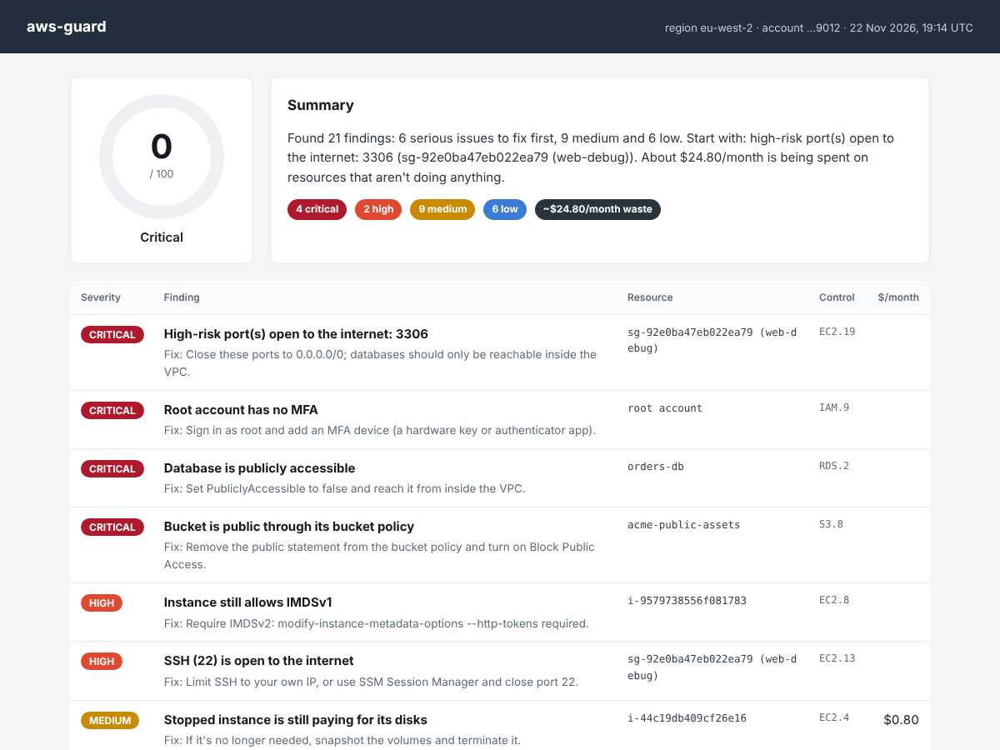

# aws-guard

**A read-only scanner that finds security risks and wasted money in an AWS account** — public buckets, open SSH,
root without MFA, databases without backups, forgotten volumes still billing — and tells you what to fix first.

Every security check maps to an official **AWS Security Hub (FSBP) control** and uses AWS's own severity.



```text
$ aws-guard --region eu-west-2
┏━━━━━━━━━━━━┳━━━━━━━━━┳━━━━━━━━━━━━━━━━━━━━━━┳━━━━━━━━━━━━━━━━━━━━━━━━━━━━━━━━━━━━━━━━━━━━━━━━━┳━━━━━━━━━┓
┃ Severity   ┃ Control ┃ Resource             ┃ Finding                                         ┃ $/month ┃
┡━━━━━━━━━━━━╇━━━━━━━━━╇━━━━━━━━━━━━━━━━━━━━━━╇━━━━━━━━━━━━━━━━━━━━━━━━━━━━━━━━━━━━━━━━━━━━━━━━━╇━━━━━━━━━┩
│  CRITICAL  │ EC2.19  │ sg-… (web-debug)     │ High-risk port(s) open to the internet: 3306    │         │
│  CRITICAL  │ IAM.9   │ root account         │ Root account has no MFA                         │         │
│  HIGH      │ EC2.13  │ sg-… (web-debug)     │ SSH (22) is open to the internet                │         │
│  LOW       │ —       │ vol-…                │ Unattached 200 GB gp2 volume is still billing   │   20.00 │
└────────────┴─────────┴──────────────────────┴─────────────────────────────────────────────────┴─────────┘
Score 0/100 (Critical) · critical 4 · high 2 · medium 9 · low 6 · ~$24.80/month waste
```

## Try it without an AWS account

```bash
pip install "git+https://github.com/macroer16/aws-guard#egg=aws-guard[demo]"
aws-guard --demo
```

`--demo` builds a fake account full of common mistakes in memory (using [moto](https://github.com/getmoto/moto))
and scans it. Open `aws-guard-report/report.html` to see the report.

## Use it on your own account

1. Create a **read-only** IAM user or role. Attach the AWS managed policies **SecurityAudit** and
   **ViewOnlyAccess**, or the minimal policy in [`iam-policy.json`](iam-policy.json).
2. Configure credentials the normal way (`aws configure --profile audit`, SSO, or environment variables).
3. Run:

```bash
pip install "git+https://github.com/macroer16/aws-guard"
aws-guard --profile audit --region eu-west-2 --output reports/
```

| Flag | What it does |
| --- | --- |
| `--region` | Region to scan (IAM is global and always included) |
| `--profile` | Named AWS profile |
| `--output` | Folder for `report.html` and `findings.json` |
| `--checks s3,iam` | Run only some checks: `s3, ebs, ec2, security_groups, iam, rds` |
| `--fail-on high` | Exit code 1 if anything is high or worse — use it in CI |
| `--ai` | Add a short AI summary. Sends **anonymised** findings only (needs `aws-guard[ai]` and `ANTHROPIC_API_KEY`) |
| `--demo` | Scan a fake account instead of yours |

## What it checks

22 checks across S3, EBS, EC2, security groups, IAM and RDS — the full list, with control IDs and severities, is
in [RESEARCH.md](RESEARCH.md#checks). Costs for unused volumes and stopped instances are estimated from
us-east-1 list prices.

## How it's built

```
src/aws_guard/
  checks/        one module per service; each returns a list of Finding objects
  models.py      Finding + Severity (CRITICAL/HIGH/MEDIUM/LOW, like Security Hub)
  scoring.py     score out of 100 and a plain-English summary
  report.py      rich terminal table, report.html (Jinja2), findings.json
  ai.py          optional summary — anonymises before sending anything
  demo.py        fake misconfigured account for --demo
```

Python 3.12 · boto3 · rich · Jinja2 · pytest + moto · ruff · GitHub Actions.

## Tests

```bash
pip install -e ".[dev]"
pytest -q        # every check is tested against a mocked AWS account (moto), clean and broken cases
ruff check src tests
```

CI runs lint, tests and a demo scan on every push.

## Security

Read-only by design. See [SECURITY.md](SECURITY.md) for exactly what it can and can't access.

---

Built by [Victor Benson](https://victor-benson.vercel.app) — AWS Certified Solutions Architect – Associate,
first-year Computer Science at the University of Westminster.
